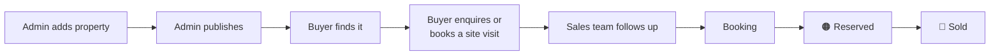
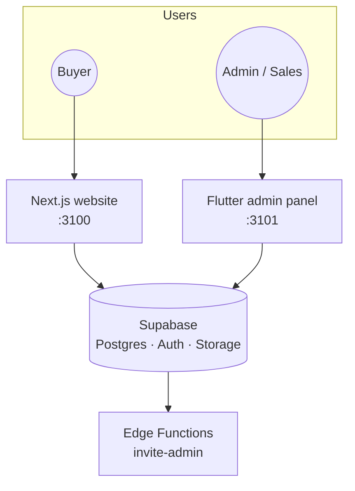

<div align="center">

# 🏞️ AVANILANDS

**Find Your Space. Build Your Future.**

A real estate and property platform from **Tirupa Technologies Pvt. Ltd.** for selling company-owned land: verified plots, farm land and investment sites, sold directly with no brokers.


</div>

---

## 📖 Contents

- [What it is](#-what-it-is)
- [How it works](#-how-it-works)
- [Features](#-features)
- [Project layout](#-project-layout)
- [Run it locally](#-run-it-locally)
- [Everyday commands](#-everyday-commands)
- [Testing](#-testing)
- [Backups and going live](#-backups-and-going-live)
- [Documentation](#-documentation)

---

## 🌱 What it is

Avanilands is **not a marketplace**. Only the company lists land. Buyers browse, compare and enquire, and the sales team follows up in a private admin panel.

| Part | Who uses it | Built with |
|------|-------------|------------|
| 🌐 **Customer website** | Buyers looking for land | Next.js 16 · TypeScript · Tailwind CSS 4 |
| 🛠️ **Admin panel** | The company's sales and admin team | Flutter web · Riverpod 3 · go_router |
| 🗄️ **Backend** | Both of the above | Supabase: Postgres, Auth, Storage, Edge Functions |

### The ground rules

1. No third-party sellers, owners, brokers or agents. There is no "post your property" anywhere.
2. Only authorised admins can create or change properties, media and website content.
3. **The database itself enforces access** through Postgres Row Level Security, not just the screens.
4. Private documents and exact locations stay hidden unless an admin marks them public.

---

## 🔄 How it works





Property status colours are used the same way everywhere: 🟢 **Available** · 🟠 **Reserved** · 🔴 **Sold**.

---

## ✨ Features

### 🌐 Customer website

- **Search and filter** by place, type, budget, area (in any unit), road width, facing, amenities and approval.
- **Property pages** with a photo gallery, map, plot details, approvals, nearby places and documents.
- **Enquire, call or WhatsApp**, and book a site visit straight from a property.
- **Compare** properties side by side, and **save** favourites to an account.
- **Sold and reserved** land is clearly marked with coloured banners, ribbons and badges.
- **SEO ready**: city landing pages, sitemap, structured data and share images.

### 🛠️ Admin panel

- **Dashboard** with inventory, sales, visitor trends, latest enquiries and recent activity.
- **Property editor** with 4 required steps (about, location, size and price, photos) and optional details folded away, plus a live "ready to publish" checklist.
- **Media**: photos (reorder, cover, alt text), YouTube or uploaded videos, and private or public documents.
- **Enquiries, site visits and bookings**, each with statuses and follow-up.
- **Analytics** for visitors, the enquiry funnel and top properties.
- **Locations and lists** for cities, property types and amenities.
- **Activity log**: every important change is recorded by the database.
- **Settings**: brand look, company details and admin users (Super Admin and Admin roles).

---

## 📁 Project layout

```
Avanilands/
├── web/          🌐 Customer website (Next.js)
│   └── src/
│       ├── app/          Pages and routes (land, compare, account, book…)
│       ├── components/   UI building blocks
│       └── lib/          Data access, formatting, SEO helpers
├── admin/        🛠️ Admin panel (Flutter web)
│   └── lib/
│       ├── core/         Theme, router, shared widgets
│       └── features/     dashboard, properties, enquiries, bookings, analytics…
├── supabase/     🗄️ Backend
│   ├── migrations/       Database schema and security rules
│   ├── functions/        Edge Functions
│   ├── tests/            Database tests
│   └── seed.sql          Sample data and local test logins
├── tool/         🧰 Scripts for running, building, backups and checks
└── docs/         📚 Requirements, decisions, design and guides
```

---

## 🚀 Run it locally

### What you need

| Tool | Version |
|------|---------|
| Node.js | 22 or newer |
| Flutter | 3.47 or newer (stable) |
| Docker | Any recent version |
| Supabase CLI | 2.x |

### 1. Start Supabase

From the project folder (the first start downloads Docker images):

```bash
supabase start
```

| Service | Address |
|---------|---------|
| API | `http://127.0.0.1:56421` |
| Database | port `56422` |
| Studio (database UI) | http://127.0.0.1:56423 |
| Email inbox (test emails) | http://127.0.0.1:56424 |

### 2. Start the website

Copy `web/.env.example` to `web/.env.local` and fill in the values from `supabase status`. Then:

```bash
npm --prefix web install
```

```bash
npm --prefix web run dev
```

➡️ Opens at **http://localhost:3100**

### 3. Start the admin panel

Copy `admin/env/example.json` to `admin/env/local.json` and fill in the values from `supabase status`. Then:

```bash
tool/run_admin.sh
```

➡️ Opens at **http://127.0.0.1:3101** (debug mode; press `r` to hot reload)

To try the release build instead, which is what gets deployed:

```bash
tool/serve_admin.sh
```

### 4. Sign in

Local test logins (Super Admin and Admin) are listed at the top of [`supabase/seed.sql`](supabase/seed.sql). They work **only on your local machine**.

### 5. Sample photos (optional)

After `supabase db reset`, give the sample properties placeholder photos (needs ffmpeg):

```bash
tool/seed_photos.sh
```

---

## 🧰 Everyday commands

| Task | Command |
|------|---------|
| New database change | `supabase migration new <name> < /dev/null` (the `< /dev/null` stops it waiting for input) |
| Rebuild the database from scratch | `supabase db reset` |
| Restart Edge Functions after an edit | `docker restart supabase_edge_runtime_avanilands` |
| Admin build for hosting | `tool/build_admin.sh admin/env/<env>.json` |

---

## 🧪 Testing

| What | Command |
|------|---------|
| Database | `supabase test db` |
| Admin panel | `cd admin && flutter test` |
| Website | `cd web && npm test` |
| Security over HTTP (website and Supabase running) | `node tool/security_check.mjs` |
| Speed test with 500 extra properties | `docker exec -i supabase_db_avanilands psql -U postgres -f - < tool/load_test_properties.sql` |

To remove the speed-test data, run `supabase db reset` and then `tool/seed_photos.sh`.

---

## 💾 Backups and going live

- **Backups:** `tool/backup_db.sh`, `tool/backup_files.mjs` and `tool/weekly_backup.sh`. Restore with `tool/restore_db.sh`. See [RECOVERY.md](docs/RECOVERY.md).
- **Staging and production setup:** [DEPLOY.md](docs/DEPLOY.md).

### 🔐 Secrets

- Never commit `web/.env.local` or `admin/env/local.json`. Only the example files are shared.
- Server-only keys such as `SUPABASE_SECRET_KEY` must **never** have the `NEXT_PUBLIC_` prefix.

---

## 📚 Documentation

| Document | What's inside |
|----------|---------------|
| [docs/README.md](docs/README.md) | Where to start and reading order |
| [Requirements](docs/00-requirements.md) | What we're building and the hard rules |
| [Decisions](docs/DECISIONS.md) | Every decision made so far |
| [Architecture](docs/01-architecture.md) | How the pieces fit, security and SEO |
| [Database](docs/02-database.md) | Tables, rules and storage |
| [Design](docs/03-design.md) | Look, feel and key screens |
| [Progress](docs/PROGRESS.md) | Where the project is now |
| [Staff guide](docs/STAFF-GUIDE.md) | How the sales team uses the admin panel |
| [Test checklist](docs/TEST-CHECKLIST.md) | The owner's test lists |

---

<div align="center">

**AVANILANDS** · Real Estate & Property Platform<br/>
A brand of Tirupa Technologies Pvt. Ltd.

</div>
